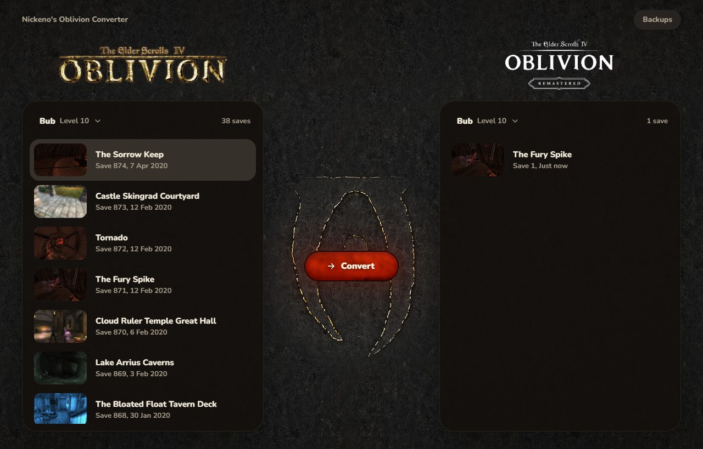

# Nickeno's Oblivion Converter

Move a save between the original Oblivion (2006) and Oblivion Remastered. It works both ways.



## Use it

1. Download `NickenosOblivionConverter.exe` from Releases and open it.
2. Pick a save on either side.
3. Press Convert, or drag the save to the other side.
4. Open Load in the other game.

Both games are found by themselves, from Steam, GOG and Game Pass / the Xbox app.

## Good to know

- Close Oblivion Remastered before you convert a save into it.
- You need one Remastered save first. The converter copies its settings from your newest one.
- The save's game data is carried over as it is. Level, stats and items were checked in both games.
- Looks are the exception: a save going into Remastered takes the look of your newest Remastered character.
- A save converted into Remastered shows up as its own character in the Load menu.
- Your existing saves are never changed. Converting always makes a new save.
- Before it adds a save to Remastered, the app zips your Remastered saves into
  `Documents\Nickeno's Oblivion Converter\Backups`. It keeps the newest 20. The Backups button opens that folder.
- The original game says the save "relies on content that is no longer present". That is Remastered's own
  plugin. Press Yes and it loads.
- Windows may warn that the app is from an unknown publisher, because it is not signed. Choose More info, then Run anyway.

This is experimental. It was tested with unmodded games: a Remastered save loaded in the original (Steam, 1.2.0416)
and an original level 126 save loaded in Remastered (Game Pass, 1.512.105.0). Saves from modded games are untested.
Keep your own backups of saves you care about.

## Run or build it from source

Windows, Python 3.12 or newer.

```
python -m venv .venv
.venv\Scripts\pip install pywebview pillow pyinstaller
.venv\Scripts\python -m osc.app
```

Remastered saves are packed with Oodle. Reading them needs `ooz.dll`, built from the source in
`third_party/ooz/src` (see `third_party/ooz/build/build.cmd`, it uses the Visual Studio C++ compiler).
A built copy is in the same folder.

Build the single .exe:

```
.venv\Scripts\python packaging\build.py
```

There is also a command line: `python -m osc --help`.

`NOTES.md` has what was worked out about both save formats.

## Credits

- [ooz](https://github.com/powzix/ooz) by powzix, for unpacking Oodle Kraken data (GPL-3.0-or-later).
- [UESP](https://en.uesp.net/wiki/Oblivion_Mod:Save_File_Format) for the original save format.
- [ORSE](https://github.com/Microb4ek/OblivionRemastered-save-editor-ORSE) (MIT), used to cross-check the Remastered format.
- [GPSaveConverter](https://github.com/Fr33dan/GPSaveConverter), for how Game Pass save folders are laid out.
- [pywebview](https://pywebview.flowrl.com/), [Pillow](https://python-pillow.org/) and the [Nunito](https://fonts.google.com/specimen/Nunito) font.

Details are in `THIRD-PARTY.md`.

## License

GPL-3.0-or-later, see `LICENSE`.

This is a fan-made tool. It is not made or endorsed by Bethesda Softworks or ZeniMax Media.
The Elder Scrolls, Oblivion, their logos and the game artwork shown in the app belong to them.
